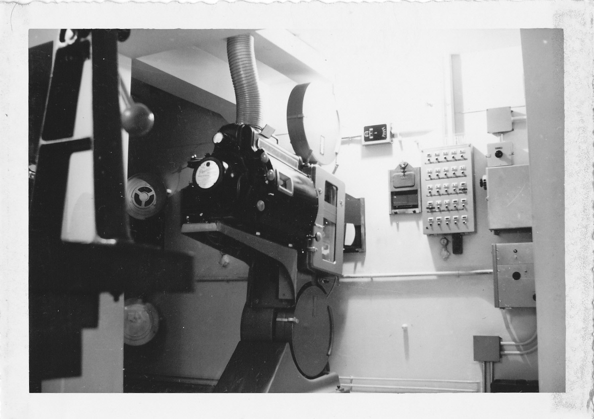

בזמן שכל העולם עבר למצלמות דיגיטליות, קבצים בענן וסטרימינג אינסופי, קורה משהו מוזר ומרתק: **פילם 70 מ"מ** — אותו פס צלולויד כבד, יקר ומיושן לכאורה — חוזר אל חזית הקולנוע. יותר ויותר במאים בולטים בוחרים לצלם על סרט פיזי, והקהל, מפתיע ככל שזה נשמע, צובא על ההקרנות הנדירות. התשובה הקצרה לשאלה "למה": הפילם מציע תחושה חזותית, עומק וטקסטורה שקשה מאוד לזייף במדיום הדיגיטלי.

## מה זה בעצם פילם 70 מ"מ?

המספר מתייחס לרוחב פס הצלולויד. ככל שהפס רחב יותר, כך הוא לוכד יותר פרטים, יותר גוני צבע ויותר עומק. פס של 70 מ"מ הוא כפול ברוחבו מהפורמט הקולנועי המסורתי של 35 מ"מ, והתוצאה על המסך הגדול היא דימוי ענק, חד להפליא ועשיר בגרעיניות עדינה — אותה "נשימה" אורגנית שחובבי הקולנוע כל כך אוהבים.

זה אינו פורמט חדש כלל. סרטי ענק קלאסיים כמו "לורנס איש ערב" או "2001: אודיסיאה בחלל" של סטנלי קובריק צולמו בפורמטים רחבים, והותירו רושם ויזואלי שממשיך להדהים גם היום. מה שהשתנה הוא ההקשר: בעידן שבו כמעט הכול מצולם ומוקרן דיגיטלית, הבחירה בפילם הפכה מהצהרה אמנותית לכמעט מרד.

## מי מחזיר את הפילם לאופנה?

אי אפשר לדבר על תחיית ה**פילם 70 מ"מ** בלי להזכיר את כריסטופר נולאן. הבמאי, מהקולות הבולטים בקולנוע העכשווי, הפך את ההתעקשות על צילום אנלוגי ועל הקרנות פיזיות לחלק מהזהות שלו. "אופנהיימר", אחד הסרטים המדוברים של השנים האחרונות, הניע מחדש שיחה ציבורית שלמה על היתרונות של הסרט הגדול, ושלח צופים לחפש אולמות שעדיין מצוידים במקרנות המתאימות.

גם קוונטין טרנטינו הוא מבשר אדוק של הפורמט. עבור "שמונת השנואים" הוא שחזר עדשות נדירות של פנאוויז'ן והפיק גרסת הקרנה מיוחדת בפורמט רחב, כולל הפסקה באמצע — מחווה גלויה לחוויית הקולנוע של פעם. גם במאים כמו פול תומס אנדרסון וגרטה גרוויג נמנים עם הדור שמחזיר כבוד לצילום על סרט.

### למה הם טורחים? היתרונות של האנלוגי

- **עומק ורזולוציה:** הפורמט הרחב לוכד כמות עצומה של מידע חזותי, במיוחד בסצנות נוף ובצילומי ענק.
- **גרעיניות אורגנית:** במקום "רעש" דיגיטלי, מתקבלת מרקמיות עדינה שמעניקה לדימוי נפח וחיים.
- **משמעת יצירתית:** סרט פיזי יקר, ולכן כל פריים מחושב. הצוות עובד בריכוז אחר לגמרי.
- **טקסים וחוויה:** הקרנת פילם היא אירוע. יש בה משהו חגיגי שהסטרימינג הביתי פשוט לא מספק.

## השוואה מהירה: פילם מול דיגיטל

| פרמטר | פילם 70 מ"מ | צילום דיגיטלי |
|---|---|---|
| מרקם הדימוי | גרעיני, אורגני | נקי, חד מאוד |
| עלות הפקה | גבוהה | נמוכה יחסית |
| גמישות בעריכה | מוגבלת | כמעט אינסופית |
| חוויית הקרנה | טקסית, נדירה | זמינה בכל מקום |
| שימור לטווח ארוך | מצוין בתנאים נכונים | תלוי בפורמטים משתנים |

## האם הקהל באמת מתרגש מזה?

כאן מסתתר החלק המעניין. אפשר היה לחשוב שרק קומץ אניני קולנוע מחפשים הקרנות פילם, אך בפועל נוצר ביקוש מפתיע. אולמות ברחבי העולם המצוידים במקרני 70 מ"מ מדווחים על אולמות מלאים וכרטיסים אזלים, ולעיתים צופים נוסעים מרחק רב רק כדי לחוות סרט בפורמט "הנכון". בעידן שבו הכול נגיש מהספה, דווקא הנדירות הפכה לערך.

יש בכך גם אמירה תרבותית רחבה יותר. בדומה לחזרת הוויניל במוזיקה או לפריחת הצילום האנלוגי, גם כאן מדובר בגעגוע אל המוחשי, אל החומר שאפשר לגעת בו ולהרגיש. הפילם אינו רק פורמט טכני — הוא הצהרה נגד החד-פעמיות של התרבות הדיגיטלית.

## ואיפה פוגשים את זה בישראל?

בישראל ההקרנות האנלוגיות נדירות הרבה יותר, בעיקר בשל מיעוט האולמות המצוידים במקרני פילם ועלויות התחזוקה הגבוהות. עם זאת, מסגרות כמו הסינמטקים בתל אביב, בירושלים ובחיפה, וכן פסטיבלים ואירועי רטרוספקטיבה, מציעים מדי פעם הקרנות של עותקי פילם קלאסיים — חוויה ששווה לחובבי הקולנוע לארוב לה. כשסרט חדש שצולם בפורמט רחב מגיע לארץ, לרוב יוקרן בגרסה דיגיטלית באיכות גבוהה, אך גם בה נשמר חלק מהקסם של הצילום המקורי.

השורה התחתונה: הפילם רחוק מלמות. דווקא בעידן הדיגיטלי המוחלט, הסרט הפיזי מצא לעצמו תפקיד חדש — לא כברירת מחדל, אלא כבחירה אמנותית מודעת, יקרה ומפוארת, שמזכירה לנו למה התאהבנו בקולנוע מלכתחילה.
