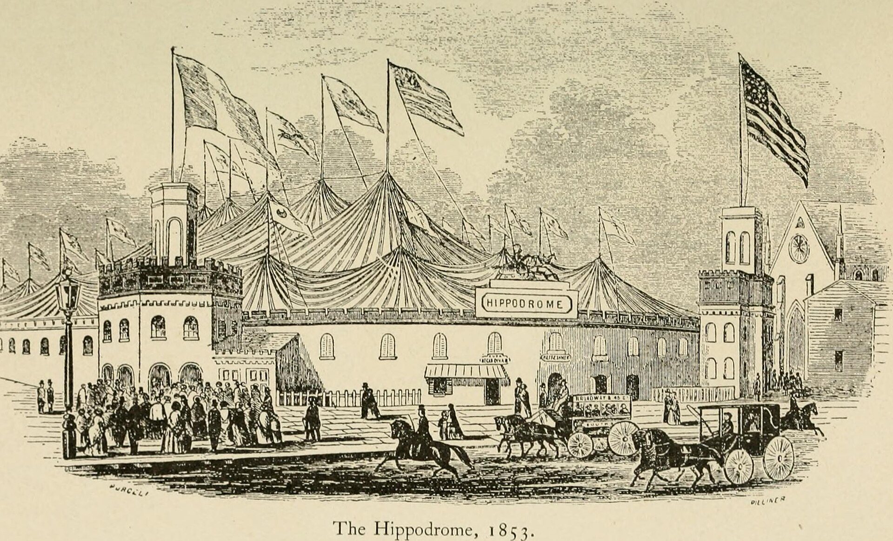

מה קורה כשהקיר הרביעי לא רק נשבר, אלא נעלם לגמרי? **תיאטרון אימרסיבי** הוא צורת מופע שבה הקהל מפסיק לשבת בשורות מסודרות ומתחיל לנוע בתוך החלל, לנשום את אותו אוויר עם השחקנים ולבחור בעצמו על מה להסתכל. זו אחת המגמות המרתקות בתיאטרון העכשווי, והיא מגיעה גם אלינו — עם הבטחה לחוויה שאי אפשר לצפות בה מהצד, רק להיכנס אליה.

## מה זה בעצם תיאטרון אימרסיבי?

בניגוד להצגה קלאסית, שבה אנחנו צופים נייחים מול במה מוארת, **תיאטרון אימרסיבי** מפרק את המבנה המסורתי. הצופה הופך לדמות אורחת בעולם ההצגה: הוא פוסע בין החדרים, מתקרב לשחקנים עד כדי נשימה, ולעיתים אפילו נדרש לבחור באיזו עלילה ללוות. המונח הקרוב לו הוא תיאטרון "סייט ספסיפיק" (site-specific) — מופע המתקיים במקום לא־תיאטרלי כמו מחסן נטוש, בית מלון ישן או מפעל, שהופך בעצמו לחלק מהסיפור.

הרעיון אינו חדש לגמרי. שורשיו נעוצים בניסויים האוונגרדיים של המאה ה-20, בתיאטרון הסביבתי ובמחשבות של יוצרים כמו אנטונן ארטו על "תיאטרון האכזריות". אך רק בעשורים האחרונים הפך הז'אנר מניסוי שולי לתופעה שמושכת קהלים המוניים.

## למה דווקא עכשיו הקהל רוצה לקום מהכיסא?

בעידן שבו מסכים מקיפים אותנו מכל עבר, הצמא לחוויה פיזית, גופנית ובלתי אמצעית רק גובר. **תיאטרון אימרסיבי** מציע בדיוק את זה: נוכחות אמיתית, סכנה קטנה של הלא־צפוי, ותחושת אחריות — כי מה שתפספס, תפספס לתמיד. הדור שגדל על משחקי מחשב וחדרי בריחה מחפש השתתפות פעילה ולא צפייה פסיבית, והתיאטרון החווייתי עונה על הרעב הזה.

ההצגה שהפכה את הז'אנר למותג בינלאומי היא **'סליפ נו מור'** (Sleep No More) של להקת פאנצ'דראנק הבריטית — עיבוד אילם ל"מקבת" של שייקספיר, שהתרחש במלון בדיוני בן חמש קומות במנהטן. הקהל, עטוי מסכות לבנות, נדד בחופשיות בין החדרים ועקב אחר דמויות לפי בחירתו. ההפקה רצה למעלה מעשור והפכה לאחת ההצלחות המדוברות בתיאטרון העולמי.

## השוואה: תיאטרון קלאסי מול אימרסיבי

| מאפיין | תיאטרון קלאסי | תיאטרון אימרסיבי |
|---|---|---|
| מיקום הקהל | יושב מול הבמה | נע בתוך החלל |
| נקודת מבט | אחת, קבועה | משתנה, אישית |
| משך הקשב | ליניארי | מפוצל, לפי בחירה |
| מרחב המופע | אולם תיאטרון | אתר לא שגרתי |
| תחושת הצופה | צפייה | השתתפות ונוכחות |

## איך זה נראה בישראל?

גם בישראל מסתמנת מגמה גוברת של תיאטרון חווייתי. פסטיבלים כמו **פסטיבל עכו לתיאטרון אחר** ו**פסטיבל ישראל** מארחים כבר שנים מופעי סייט ספסיפיק המתרחשים בסמטאות, במבצרים ובמבנים היסטוריים. לצידם צמחה סצנה ענפה של חוויות עלילתיות — מחדרי בריחה מתוחכמים ועד סיורים תיאטרליים ליליים בשכונות תל אביב וירושלים, שמטשטשים את הגבול בין משחק, הצגה ואירוע.

מוסדות הדגל, מ**תיאטרון הבימה** ועד הבמות העצמאיות של תיאטרון הפרינג', מתנסים אף הם בפורמטים שמקרבים את הקהל אל השחקנים. הקהל הישראלי, הידוע בחיבתו למעורבות ולספונטניות, מתגלה כקרקע פורייה במיוחד לז'אנר הזה.

## האתגרים שמאחורי הקסם

החופש שמעניק **תיאטרון אימרסיבי** מגיע עם מחיר. הבימוי מורכב פי כמה: על היוצרים לתכנן עלילה שתעבוד מכל זווית, לכל צופה בנפרד, גם אם יבחר ללכת בכיוון "הלא נכון". ישנם אתגרי בטיחות, ניהול קהל, ותחזוקת חלל עשיר בפרטים. לא פעם עולה גם שאלה ביקורתית: האם המעורבות מעמיקה את החוויה, או שמא היא גימיק שמסיח מהתוכן?

עם זאת, כשזה מצליח — התוצאה בלתי נשכחת. הצופה אינו זוכר רק מה ראה, אלא **איפה עמד, מה הרגיש ואת מי בחר ללוות**. זו בדיוק ההבטחה של הז'אנר: להפוך כל אחד מאיתנו מצופה לעד, ואולי אפילו למשתתף בסיפור.

## למי זה מתאים?

אם אתם אוהבים תיאטרון אבל מתגעגעים לאדרנלין, אם אתם סקרנים לגעת בגבול שבין מציאות לבדיה, או פשוט מחפשים ערב שונה מכל מה שהכרתם — שווה לחפש הפקה אימרסיבית בקרבתכם. רק אל תשכחו: כאן אין מנוחה על הכיסא. תביאו נעליים נוחות.
