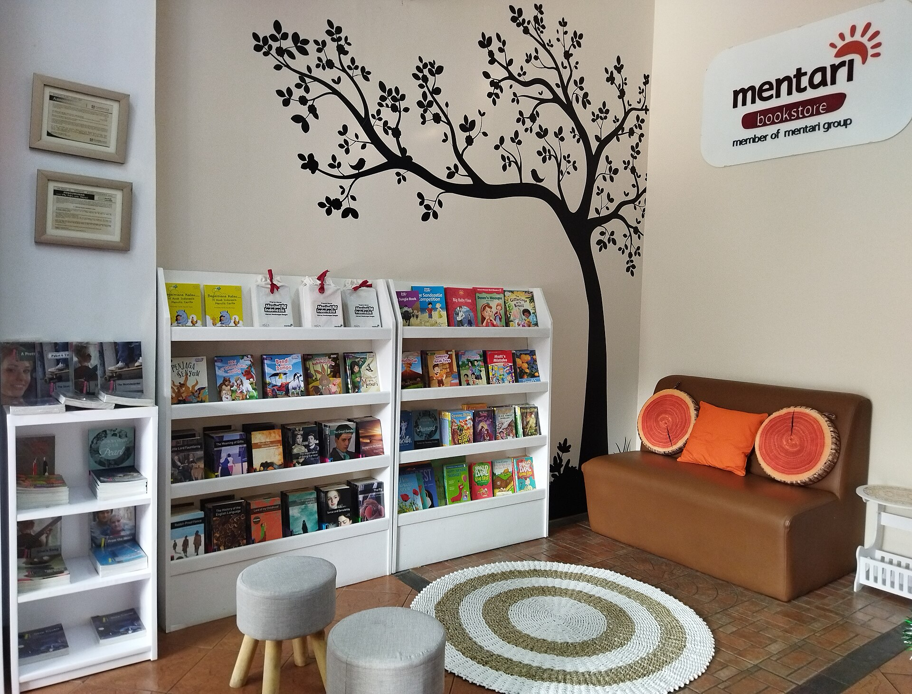

האם אפשר לקרוא ספר שלם בערב אחד ולצאת ממנו המום כאילו קראתם רומן של 500 עמוד? התשובה היא כן — והיא הסיבה שהנובלה חוזרת בגדול. בעידן של ריכוז מתפורר, מדפים קורסים תחת לבנים בנות מאות עמודים ותחרות בלתי פוסקת מול המסך, דווקא הספר הדק והחד הפך לאחד הטרנדים המעניינים בשוק הספרים — בישראל ובעולם.

הנובלה, אותו יצור ביניים בין הסיפור הקצר לרומן, נעה בדרך כלל בין 60 ל-150 עמודים. היא ארוכה מספיק כדי לבנות עולם ודמויות, אך קצרה מספיק כדי להישאר דחוסה, מזוקקת, בלי שומן מיותר. ורבים רואים בה בדיוק את התשובה לרוח התקופה.

## למה הנובלה חוזרת דווקא עכשיו?

הסיבה הראשונה פשוטה: זמן. הקורא בן זמננו מחולק בין פלטפורמות, התראות וסדרות. ספר שאפשר לסיים בישיבה אחת מציע תחושת הישג נדירה — התחלה, אמצע וסוף בתוך ערב. בעולם שבו "ערימת הספרים שלא קראתי" הפכה למקור חרדה, הנובלה היא ניצחון קטן ומיידי.

הסיבה השנייה היא איכותנית. הקיצור כופה על הסופר משמעת. אין מקום לפסקאות מילוי, לעלילות משנה מפותלות או לתיאורי נוף של עמוד וחצי. כל משפט חייב לשאת משקל. התוצאה, כשהיא מצליחה, היא ספרות בעלת צפיפות רגשית יוצאת דופן.

וישנה גם סיבה שלישית, תרבותית: הרשתות החברתיות. בדומה לאופן שבו וידאו קצר עיצב מחדש את צריכת התוכן, גם הקוראים הצעירים מחפשים חוויות ספרותיות שלמות שאפשר להמליץ עליהן, לסיים במהירות ולהעביר הלאה.

## מי הוכיח שהקיצור הוא אמנות?

ההיסטוריה הספרותית מלאה במאסטרים של הפורמט הקצר. ארנסט המינגוויי זיקק את סגנונו המינימליסטי לנובלות כמו "הזקן והים". אלבר קאמי העמיד ב"הזר" את אחת היצירות המשפיעות של המאה ה-20 בפחות מ-150 עמוד. הכלת הנובלה הפרסית פרנץ קפקא ב"הגלגול" הראתה כמה רחוק אפשר להגיע בקצת.

גם בדורנו הכותבים הגדולים לא מזלזלים בפורמט. איאן מקיואן (מחבר "כפרה") חוזר שוב ושוב לנובלה החדה. הזוכה הארגנטינאית קלאודיה פיניירו בונה מתח בספרים קצרים ומהודקים. ואליס מונרו, זוכת פרס נובל, הוכיחה שגם "סיפור ארוך" יכול להכיל חיים שלמים. בישראל, סופרים כמו עמוס עוז ("סיפור על אהבה וחושך" הוא דווקא עבה, אבל "מיכאל שלי" ורבים אחרים מהודקים) ואתגר קרת, אלוף הזיקוק, מזכירים שהקצר אינו נחות מהארוך.

## נובלה מול רומן: מה ההבדל?

| פרמטר | נובלה | רומן |
|---|---|---|
| אורך טיפוסי | 60–150 עמודים | 250–600 עמודים |
| זמן קריאה | ערב אחד עד שניים | שבוע ויותר |
| מבנה | עלילה אחת מזוקקת | עלילות משנה מרובות |
| חוזקה | צפיפות רגשית, חדות | עומק, רוחב יריעה |
| אתגר ליוצר | כל מילה נספרת | שליטה במבנה רחב |

## מה כדאי לקרוא? המלצות להתחלה

אם אתם רוצים לבדוק למה הנובלה חוזרת, הנה כמה כיווני פתיחה — חלקם קלאסיקות, חלקם עכשוויים:

- **"הזר" / אלבר קאמי** — יצירת מופת קיומית שאפשר לבלוע בישיבה אחת ולעכל שנים.
- **"הגלגול" / פרנץ קפקא** — נקודת פתיחה מושלמת למי שרוצה להבין מה כוחו של הקיצור.
- **"על חוף צ'זיל" / איאן מקיואן** — דרמה זוגית דחוסה ועוצרת נשימה.
- **נובלות של קלאודיה פיניירו** — מתח לטיני חכם, חברתי ומהיר.
- **סיפורים ארוכים של אלינה ברונסקי או אנני ארנו** — פרוזה חדה, אישית ומזוקקת.

## האם זו אופנה חולפת או שינוי של ממש?

קל לפטור את התופעה כגחמה של דור קצר-ריכוז, אבל זה יהיה פספוס. ההוצאות הקטנות והבינוניות בישראל כבר מזמן מבינות את הפוטנציאל: נובלה מתורגמת זולה יותר להפקה, קלה יותר לשיווק, ומזמינה קוראים חדשים שנרתעים מלבנים. סדרות של ספרים דקים בעיצוב מוקפד הפכו למדף נחשק אצל חובבי הספר.

וחשוב מכך: הנובלה מחזירה לספרות משהו שהאלגוריתמים גזלו — את החוויה המרוכזת, המלאה, שאפשר להכיל במכה אחת. בעולם שמפורר את תשומת הלב שלנו לרסיסים, הספר הקצר אינו ויתור על עומק. הוא הוכחה שעומק לא נמדד בעמודים.
