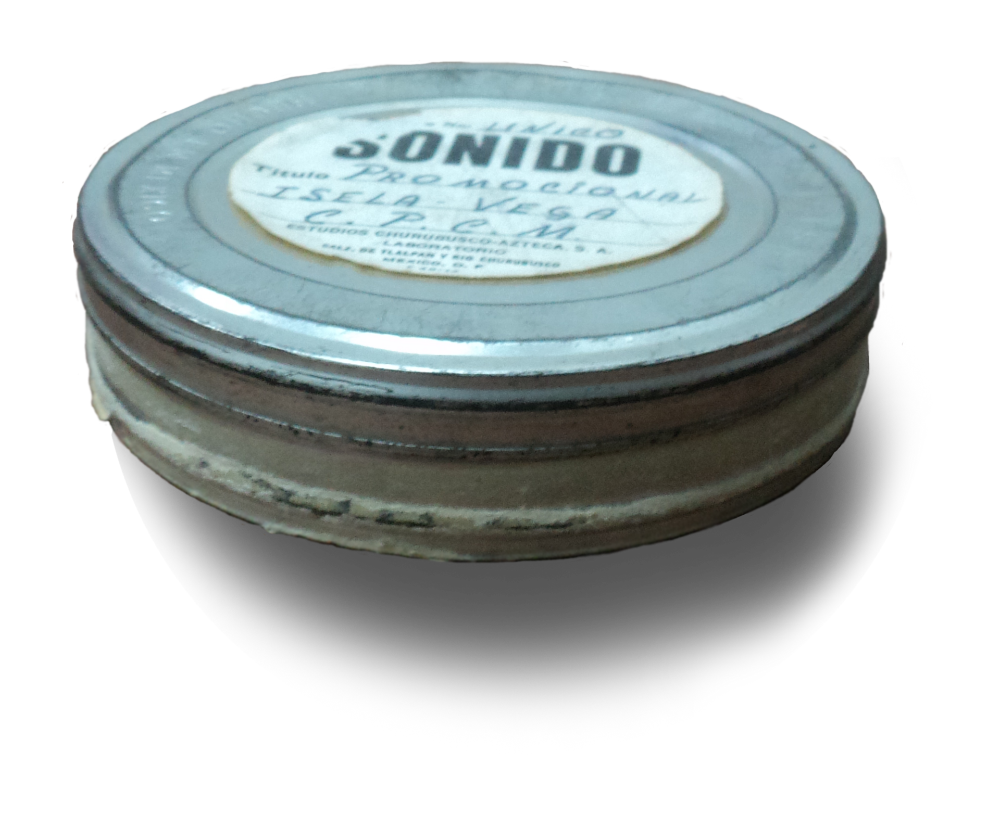

בזמן שתעשיית הקולנוע כולה עברה מזמן למצלמות דיגיטליות, לכוננים קשיחים ולהקרנות קבצים, קבוצה הולכת וגדלה של יוצרים בוחרת ללכת אחורה — אל גלילי הצלולואיד הכבדים, אל ריח הכימיקלים של המעבדה ואל הגרעיניות הרכה של הדימוי. **צילום על פילם** הפך בשנים האחרונות מריטואל נכחד להצהרה אמנותית, ולעיתים גם למוקד שיווקי של ממש. אז למה דווקא עכשיו, בעידן שבו הכול ניתן לדחיסה לפיקסלים, חוזרים הבמאים המשפיעים ביותר אל החומר הפיזי?

## מה עומד מאחורי חזרת הפילם?

התשובה הקצרה: תחושה. רבים מהיוצרים טוענים שהפילם לוכד אור, צבע ועומק בצורה שהחיישן הדיגיטלי עדיין מתקשה לשחזר. הגרעיניות העדינה, טווח הגוונים הרחב וה"אי-מושלמות" האורגנית יוצרים דימוי שנתפס כחי יותר, נושם יותר. זו אינה רק נוסטלגיה — זו בחירה אסתטית מכוונת, סוג של התנגדות לסטריליות הדיגיטלית.

הדמות הבולטת ביותר במאבק הזה היא **כריסטופר נולאן**, שהפך את הצילום על פילם ואת פורמט האיימקס לחתימה אישית. ב"אופנהיימר", למשל, הוא דחף את הטכנולוגיה למקומות חדשים וצילם חלקים נרחבים באיימקס בשחור-לבן. גם **קוונטין טרנטינו** הוא נושא דגל ותיק, שחזר להקרין את "שמונת השנואים" בפורמט 70 מ"מ רחב, בניסיון להחזיר לקהל חוויה קולנועית שנעלמה.

## למה 70 מ"מ נחשב לגביע הקדוש?

כדי להבין את ההתלהבות צריך להכיר את ההיררכיה של הפורמטים. רוב הסרטים האנלוגיים צולמו היסטורית על פילם ברוחב 35 מ"מ. פורמט 70 מ"מ, לעומת זאת, מכפיל כמעט את שטח הנגטיב ובכך מספק רזולוציה, חדות ועומק יוצאי דופן — דימוי ענק שממלא את המסך בפרטים. במאים כמו **פול תומאס אנדרסון** ("יהיה דם", "חוט רפאים") השתמשו בו כדי להעניק לסרטיהם ממד מונומנטלי.

החיסרון ברור: זה יקר להחריד, דורש מצלמות נדירות וכבדות, ומחייב רשת מצומצמת של אולמות שמסוגלים בכלל להקרין את הפורמט. דווקא הנדירות הזו הפכה את ההקרנה בפילם לאירוע — כרטיס לחוויה שלא ניתן לשחזר בבית על מסך טלוויזיה.

### טבלת השוואה: פילם מול דיגיטל

| פרמטר | צילום על פילם | צילום דיגיטלי |
|---|---|---|
| מרקם הדימוי | גרעיניות אורגנית, רכות | חד ונקי, לעיתים סטרילי |
| טווח דינמי | רחב במיוחד באורות | משתפר אך עדיין מוגבל |
| עלות הפקה | גבוהה מאוד | נמוכה יחסית |
| גמישות בצילום | מוגבלת (אורך גליל) | כמעט בלתי מוגבלת |
| חוויית הקרנה | אירועית, נדירה | זמינה בכל אולם |

## האם זו רק נחלתם של ותיקים?

ממש לא. אחד הדברים המרתקים במגמה הוא שדווקא יוצרים צעירים מאמצים אותה בהתלהבות. במאיות ובמאים בני הדור הדיגיטלי, שגדלו על טלפונים חכמים, מגלים בפילם אמצעי ביטוי מרענן. **גרטה גרוויג** צילמה את "נשים קטנות" על פילם כדי להעניק לו חום קלאסי, ו**רוברט אגרס** ("המגדלור") עשה שימוש נועז בפורמטים אנלוגיים ישנים כדי ליצור אווירה מאיימת.

גם בקרב קהל הצעירים ניכרת תשוקה מחודשת לאנלוגי — אותה מגמה שהחזירה את הוויניל ואת מצלמות הפילם לחיים. יש כאן געגוע לחומריות, לתהליך האיטי ולתחושה שמשהו אמיתי התרחש מול המצלמה.

## איפה אפשר לחוות את זה בישראל?

החדשות הטובות: גם בישראל אפשר לפגוש את הקסם. הסינמטקים — ובראשם **סינמטק תל אביב** ו**סינמטק ירושלים** — מקרינים מעת לעת עותקי פילם משוחזרים של קלאסיקות, במסגרת רטרוספקטיבות ופסטיבלים. אולמות האיימקס הגדולים מביאים את ההפקות הגדולות בפורמט המרשים ביותר הזמין מסחרית.

המלצתנו: עקבו אחר התוכניות המיוחדות של הסינמטקים, ובכל פעם שסרט של נולאן, טרנטינו או אנדרסון יוצא — חפשו את ההקרנה בפורמט המקורי הגדול ביותר. ההבדל, מבטיחים לכם, מורגש כבר מהפריים הראשון.

## מהפכה או קפריזה?

הציניקנים יטענו שמדובר בגחמה יקרה של במאי-על שיכולים להרשות לעצמם, בעוד התעשייה כולה ממשיכה דיגיטלית. ויש בכך אמת. אבל מתחת לפני השטח מסתתר ויכוח עמוק יותר על מהות הקולנוע: האם הוא רק תוכן שמזרימים, או חוויה פיזית, אירועית, שיש בה טקס? **צילום על פילם** הוא הניסיון לשמר את התשובה השנייה — ולהזכיר לנו שהקסם של הקולנוע התחיל, בסופו של דבר, מגליל של אור.
