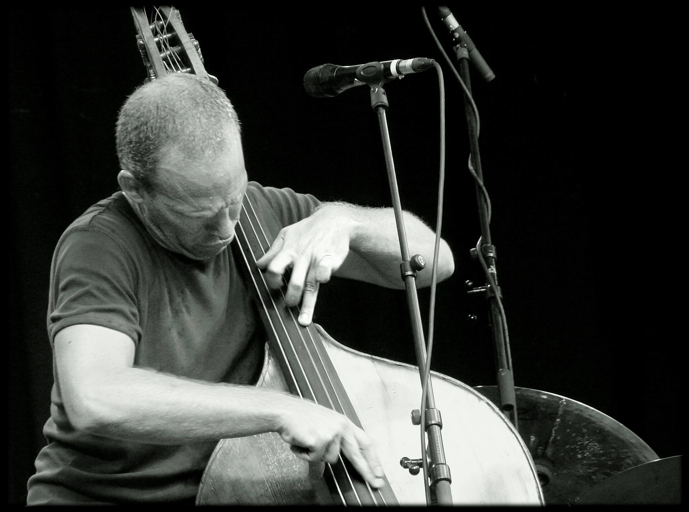

יש משהו כמעט פרדוקסלי בכך שמדינה קטנה כמו ישראל הפכה למעצמה בעולם הג'אז. ובכל זאת, זו המציאות: **ג'אז ישראלי** הוא כיום מונח מוכר באוזני מפיקים, מבקרים וקהל ממועדוני ניו יורק ועד פסטיבלים באירופה. הדור של אבישי כהן, עמרי מור ושי מאסטרו הוכיח שהשפה הזו — שנולדה בניו אורלינס — יכולה לדבר בעברית, בערבית ובצלילים ים-תיכוניים, ולהישמע חדשה לגמרי.

איך קרה שדווקא כאן, בפינה הזו של הים התיכון, צמחה אחת מחטיבות היצוא התרבותיות המפתיעות של ישראל? התשובה טמונה בשילוב בין חינוך מוזיקלי רציני, פתיחות תרבותית ורעב אמנותי שלא מרפה.

## למה הג'אז הישראלי נשמע אחרת?

הסוד של הסצנה המקומית הוא בעצם היעדר הסוד — או ליתר דיוק, ריבוי המקורות. נגן ישראלי ממוצע גדל על הרמוניה מערבית קלאסית, אבל גם על מקאם מזרחי, על פיוטים, על מוזיקה ים-תיכונית ועל רוק. כשכל זה נכנס לכור ההיתוך של האלתור הג'אזי, מתקבל צליל שקשה לבלבל עם אחר.

קחו למשל את אבישי כהן, הקונטרבסיסט שהפך לשם דבר. בהרכביו משתלבים מוטיבים ממזרח התיכון, קטעי שירה בלדינו וגרוב שמזכיר לפעמים יותר רחבת ריקודים מאשר מועדון ג'אז מעושן. השפה הזו — חמה, מלודית, נגישה — פתחה את הז'אנר לקהל רחב בהרבה מחוג המבינים.

### דור שלם של שגרירים

מעבר לכהן, יש כיום דור שלם של מוזיקאים ישראלים שבונים קריירות בינלאומיות. הפסנתרן שי מאסטרו, בוגר שנים של נגינה לצד כהן, מקליט כסולן לאחת מחברות הג'אז היוקרתיות בעולם. החצוצרן והסקסופוניסט אבישי כהן (השני, לבלבול הנצחי) מוביל הרכבים ניסיוניים. עמרי מור, שי אבני, אנאט כהן הקלרניתנית — כל אלה שמות שמופיעים בלוחות ההופעות של מועדונים ופסטיבלים מרכזיים ברחבי העולם.

מה שמחבר ביניהם אינו סגנון אחיד אלא גישה: סקרנות חסרת גבולות, כבוד למסורת לצד נכונות לשבור אותה, ותחושה שהמוזיקה הזו היא שפת אם ולא שפה שנייה.

## איפה שומעים ג'אז ישראלי חי?

החדשות הטובות הן שלא צריך לטוס לניו יורק. הסצנה המקומית תוססת, גם אם לעיתים נסתרת. הנה מפת דרכים קצרה למי שרוצה להתחיל:

| מסגרת | אופי | למי מתאים |
|---|---|---|
| מועדוני ג'אז אינטימיים בתל אביב | הופעות שבועיות, הרכבים משתנים | מי שאוהב קרבה לבמה ואלתור חי |
| פסטיבל הג'אז בים האדום (אילת) | אירוע דגל ותיק, אמנים מהארץ ומהעולם | חובבים שרוצים חוויה מרוכזת |
| סינמטקים ובתי תרבות | ערבי ג'אז, הקרנות וקונצרטים | קהל שמחפש שילוב של תרבות ומוזיקה |
| בתי ספר ומכללות למוזיקה | הופעות סטודנטים, כניסה חינם לרוב | מי שרוצה לגלות את הכוכבים של מחר |

העצה שלנו: אל תחכו לשם הגדול. חלק מהרגעים המרגשים ביותר בג'אז קורים בדיוק במועדון קטן, כשהרכב צעיר לוקח סיכון ומגלה משהו בזמן אמת.

## מסורת שמתחדשת כל הזמן

אחת הטענות הנפוצות נגד הג'אז היא שמדובר במוזיקה "של פעם", שמור לדור מבוגר. הסצנה הישראלית מפריכה את זה שוב ושוב. מוזיקאים צעירים משלבים אלקטרוניקה, היפ-הופ וגרוע ים-תיכוני, ומביאים את הג'אז אל קהל שבכלל לא התכוון להאזין לו.

זה חלק ממגמה רחבה יותר: בשנים האחרונות, בעולם כולו, ג'אז חוזר להיות רלוונטי דרך פריצות גבולות — ממש כפי שקרה בלונדון עם הגל של נגנים צעירים שחיברו את הז'אנר לקלאב. בישראל, המקבילה היא החיבור בין האלתור לבין שורשים מזרחיים וים-תיכוניים, חיבור שמרגיש אותנטי דווקא משום שהוא לא מאולץ.

## אז מאיפה מתחילים?

אם מעולם לא נתתם לז'אנר הזה הזדמנות, התחילו מהנגיש: אלבום של אבישי כהן עם הקולות והמלודיות הים-תיכוניות, או הקלטה של שי מאסטרו שתוכיח לכם כמה פסנתר יכול להיות מרגש. ואז — צאו מהבית. הג'אז הישראלי נבנה על אנרגיה חיה, על ההפתעה של הרגע, ועל הכימיה בין נגנים שמקשיבים זה לזה בנשימה אחת.

זו אולי הדרך הטובה ביותר להבין למה העולם כולו מקשיב לנו.
