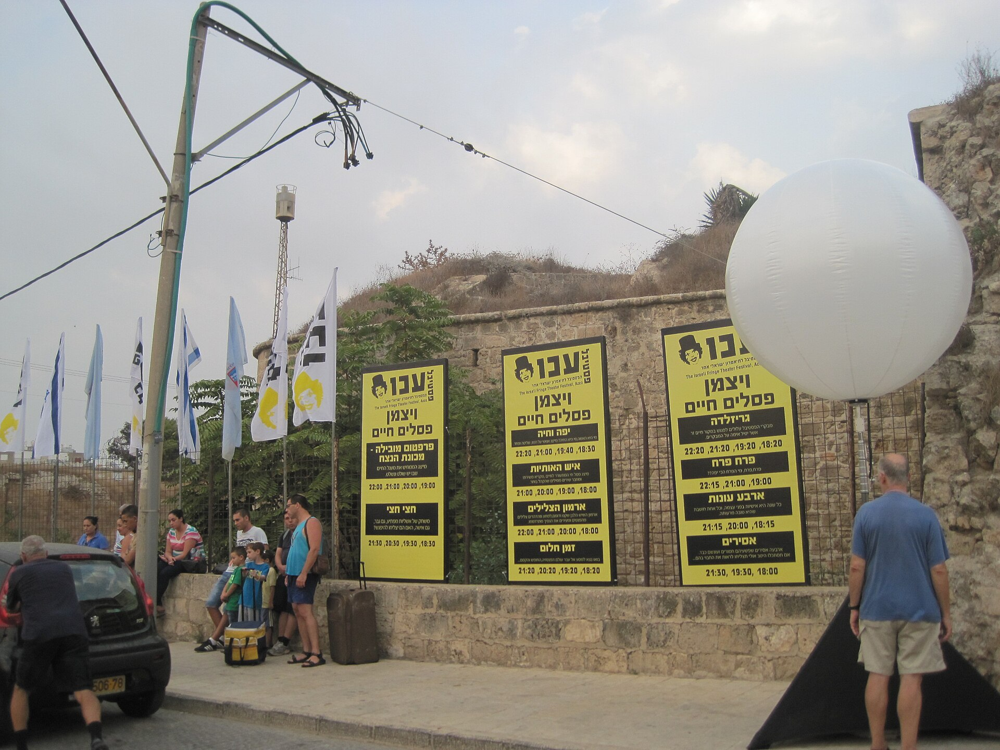

מה זה בעצם תיאטרון אימרסיבי, ולמה כולם מדברים עליו? בקצרה: זהו סוג של תיאטרון שבו הקהל מפסיק לשבת בחושך ומתחיל לנוע בתוך ההצגה — בין חדרים, מסדרונות ותפאורות — לעיתים עוקב אחרי שחקן בודד, לעיתים נוגע באביזרים, ולפעמים אפילו משתתף בעלילה. במקום הבמה המרוחקת והכורסה הנוחה, מקבל הצופה חוויה חושית, אינטימית וסוחפת שמטשטשת את הגבול בין צופה למשתתף.

בשנים האחרונות הפך **התיאטרון האימרסיבי** לאחת המגמות המסקרנות בעולם הבמה, וגם בישראל הוא מתחיל לתפוס אחיזה — מבמות הפרינג' ועד פרויקטים מיוחדים בסינמטקים, מוזיאונים ומבנים נטושים.

## מאיפה הגיעה החוויה הזאת?

השורשים של הרעיון עמוקים — אפשר למצוא אותם כבר בתיאטרון הסביבתי ובהפנינגס של שנות השישים והשבעים, כשיוצרים ניסיוניים ביקשו לשבור את ה'קיר הרביעי' ולהוציא את ההצגה אל הרחוב, המפעל או המחסן. אבל הפריצה הגדולה אל התודעה הרחבה הגיעה עם להקת **פאנצ'דראנק** (Punchdrunk) הבריטית, שההפקה שלה 'Sleep No More' — עיבוד חופשי ואפל ל'מקבת' של שייקספיר — הפכה לתופעה בינלאומית. הקהל, חבוש מסכות, שוטט לבדו בין קומות של מלון מדומה ובחר בעצמו אחרי מי לעקוב ומה לראות.

ההצלחה הזו פתחה את הדלת לגל שלם של יוצרים שהבינו דבר פשוט: בעידן של מסכים, התראות וצפייה פסיבית אינסופית, הקהל צמא לחוויה שלא ניתן לעשות 'סקרול' עליה.

## למה דווקא עכשיו, ולמה בישראל?

התשובה קשורה ישירות לתרבות הדיגיטלית. ככל שהחיים שלנו עוברים למסך, גדל הרעב לחוויה גופנית, נוכחת ובלתי ניתנת לשכפול. התיאטרון האימרסיבי מציע בדיוק את זה: ערב שבו אתה *בתוך* הסיפור, ולא מולו.

בישראל, שבה סצנת הפרינג' והתיאטרון הניסיוני תוססת — מאירועים בתיאטרון החדר ועד פסטיבל עכו לתיאטרון אחר — הקרקע פורייה במיוחד. יוצרים צעירים מנצלים מרחבים לא שגרתיים: דירות פרטיות, מחסנים בדרום תל אביב, חללי גלריה ומבני לשימור. היתרון ברור, אך גם המחיר: החוויה אינטימית, הקהל קטן, ולכן הכרטיסים מעטים ומבוקשים.

## מה מבדיל תיאטרון אימרסיבי מהצגה רגילה?

כדי לעשות סדר, הנה השוואה פשוטה בין שתי החוויות:

| מאפיין | תיאטרון קלאסי | תיאטרון אימרסיבי |
|---|---|---|
| מיקום הקהל | יושב באולם, מול הבמה | נע בתוך המרחב |
| תפקיד הצופה | פסיבי, צופה | פעיל, משתתף |
| המרחב | אולם עם במה מוגדרת | מבנה, דירה, מחסן, מוזיאון |
| גודל הקהל | מאות עד אלפים | עשרות בודדות |
| מהלך העלילה | ליניארי לכולם | אישי, משתנה לפי בחירה |
| החוויה | התבוננות | טבילה חושית מלאה |

## מה חשוב לדעת לפני שהולכים?

חוויה אימרסיבית דורשת פתיחוּת. אלה כמה דברים ששווה לקחת בחשבון:

- **נעליים נוחות.** סביר שתעמוד ותלך הרבה, לפעמים שעה או יותר.
- **אין 'מקום טוב'.** החוויה שלך תהיה שונה מזו של האדם לידך — זה חלק מהקסם.
- **רמת מעורבות משתנה.** חלק מההפקות מזמינות אינטראקציה ישירה, אחרות שומרות מרחק. שווה לבדוק מראש.
- **קהל קטן = כרטיסים מעטים.** אם משהו מסקרן אתכם, אל תחכו לרגע האחרון.
- **זה לא לכולם — וזה בסדר.** מי שאוהב לשבת בשקט ולהתבונן עשוי להרגיש חשוף; מי שמחפש אדרנלין תרבותי ימצא כאן זהב.

## האם זו רק אופנה חולפת?

יש המטילים ספק ושואלים אם מדובר בגימיק. אבל הנתונים מהעולם מצביעים דווקא על התבססות: הפקות אימרסיביות רצות שנים, מושכות קהל צעיר שנרתע לעיתים מהתיאטרון ה'ממוסד', ומשלבות אלמנטים ממשחקי בריחה, מיצג אמנותי וקולנוע. במובן הזה, התיאטרון האימרסיבי אינו מחליף את הבמה הקלאסית אלא מרחיב אותה — ומזכיר לנו שהתיאטרון, בבסיסו, הוא מפגש חי בין בני אדם במרחב משותף.

אז בפעם הבאה שתשמעו על הצגה שמתרחשת במחסן נטוש או בדירה אנונימית, ושמבקשת מכם לקום מהכיסא — קחו את ההזמנה ברצינות. ייתכן שתגלו צורה חדשה לגמרי להיות קהל.
