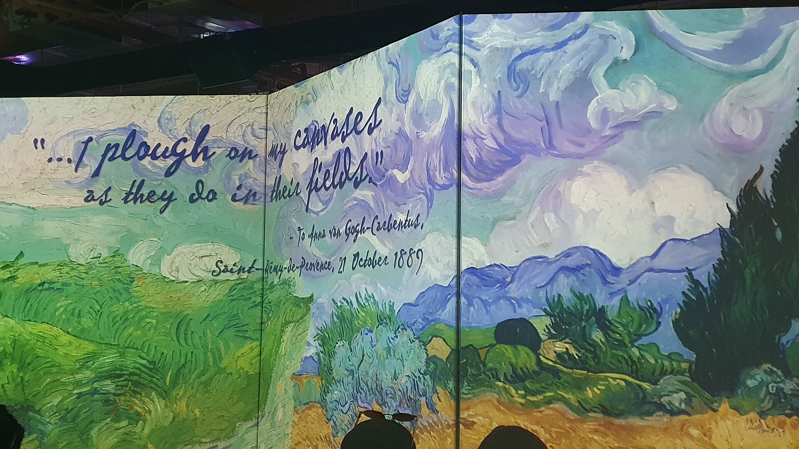

נכנסים לחלל חשוך, הקירות נמסים לשדות חיטה מתנופפים, פרחי חמניות גדולים כמו בית נפתחים סביבכם, ומוזיקה עוטפת ממלאת את האוויר. זו **אמנות חווייתית** — סוגה שבה היצירה לא תלויה על הקיר אלא מקיפה אתכם מכל עבר, הופכת אתכם מצופים למשתתפים. בשנים האחרונות הפכה הסוגה הזו לאחת התופעות הבולטות בעולם האמנות, וגם קהל ישראלי פוגש אותה יותר ויותר בחללי ענק ובאירועי לילה.

## מה זה בעצם אמנות חווייתית?

המונח מתאר יצירות שמעצבות סביבה שלמה — אור, קול, תנועה ולעיתים ריח ומגע — כך שהגוף כולו נכנס לתוך העבודה. במקום מרחק מכובד בין הצופה לתמונה, האמנות החווייתית מבטלת את הגבול. לעיתים מדובר בהקרנות ענק על קירות ותקרות, לעיתים במיצבי אור אינטראקטיביים שמגיבים לתנועה, ולעיתים בחדרי מראות אינסופיים כמו אלה של יאיוי קוסאמה (Yayoi Kusama), שהפכו לסמל של הסוגה.

השורשים נטועים עמוק: אמני התקנה (אינסטליישן) כמו קוסאמה והאמן הדני-איסלנדי אולפור אליאסון (Olafur Eliasson) עסקו שנים בחללים טוטאליים. אך הפריצה ההמונית הגיעה עם הטכנולוגיה הדיגיטלית, שאפשרה להפוך כל מחסן ריק לקתדרלה של אור.

## למה דווקא עכשיו?

כמה כוחות נפגשו יחד. הטכנולוגיה של מקרנים חזקים ומערכות סאונד הוזילה והונגשה. הרשתות החברתיות יצרו ביקוש עצום לחללים "צילומיים" שמתחננים לסטורי. והקהל, שרגיל למסכים בכל רגע, מחפש חוויה פיזית וטוטאלית שאי אפשר לקבל בבית.

הדוגמה המפורסמת ביותר היא גל תערוכות ההקרנה המוקדשות לוינסנט ואן גוך (Vincent van Gogh), שסבבו את העולם ומשכו מיליוני מבקרים. במקביל פרצה קבוצת טימלאב (teamLab) היפנית, שהקימה מוזיאונים דיגיטליים שלמים בטוקיו — גנים וירטואליים של אור שמגיבים למגע ולנוכחות הגוף, ומטשטשים לחלוטין את הגבול בין טבע לטכנולוגיה.

## אמנות גבוהה או מלכודת לאינסטגרם?

כאן מתחיל הוויכוח. מבקרים נוקשים טוענים שחלק מהתערוכות החווייתיות — במיוחד הקרנות של ציירים קלאסיים — אינן אמנות מקורית אלא עיבוד ראוותני ליצירות קיימות, מעין לונה פארק תרבותי שמוכר חוויה ולא מחשבה. אחרים משיבים שהסוגה פותחת את שערי האמנות לקהל חדש, שאולי לעולם לא היה נכנס למוזיאון קלאסי.

האמת, כמו תמיד, מורכבת. יש הבדל עצום בין הקרנה מסחרית של חמניות ואן גוך לבין יצירה מקורית של אליאסון או קוסאמה, שבה החלל עצמו הוא אמירה אמנותית. הסוגה מכילה את שני הקצוות — ועל הצופה להבחין ביניהם.

## טבלה: סוגי התערוכות החווייתיות

| סוג | מה חווים | דוגמה בולטת |
|---|---|---|
| תערוכת הקרנה | יצירות קלאסיות מוקרנות על קירות ענק | ואן גוך האימרסיבי |
| מוזיאון דיגיטלי | חללי אור אינטראקטיביים שמגיבים לתנועה | טימלאב, טוקיו |
| חדרי אינסוף | מראות ואורות שיוצרים מרחב אינסופי | יאיוי קוסאמה |
| מיצב סביבתי | התערבות באור ובתפיסה החושית | אולפור אליאסון |

## מה קורה בישראל?

גם כאן הגל מורגש. מוזיאון תל אביב לאמנות וגלריות עצמאיות מציגים יותר ויותר מיצבי וידאו ואור, ואירועי "לילה לבן" והלילה במוזיאונים הפכו את החוויה הפיזית והחושית לכוכבת. חללי תעשייה נטושים בדרום תל אביב ובפריפריה הופכים מדי פעם לתערוכות הקרנה גדולות, והקהל הישראלי — שאוהב חוויה ואוהב להצטלם — מגיב בהתלהבות.

האתגר של היוצרים המקומיים הוא לא להסתפק בחיקוי של המודל המסחרי, אלא לייצר תוכן מקורי שמדבר על המקום, הזהות והנוף הישראלי. כשזה קורה — כשהטכנולוגיה משרתת רעיון ולא רק אפקט — האמנות החווייתית יכולה להיות הרבה יותר מרקע לתמונה יפה.

## אז כדאי ללכת?

בהחלט — אבל עם ציפיות נכונות. אל תגיעו בחיפוש אחר העומק של ביקור במוזיאון קלאסי, אלא אחר חוויה חושית שעוטפת את הגוף. בחרו תערוכות שמציעות יצירה מקורית ולא רק הקרנה, הגיעו בשעות פחות עמוסות, והניחו לרגע את הטלפון כדי פשוט להיות בתוך האור. זו, בסופו של דבר, ההבטחה האמיתית של הסוגה: לא לראות אמנות — אלא להיכנס לתוכה.
