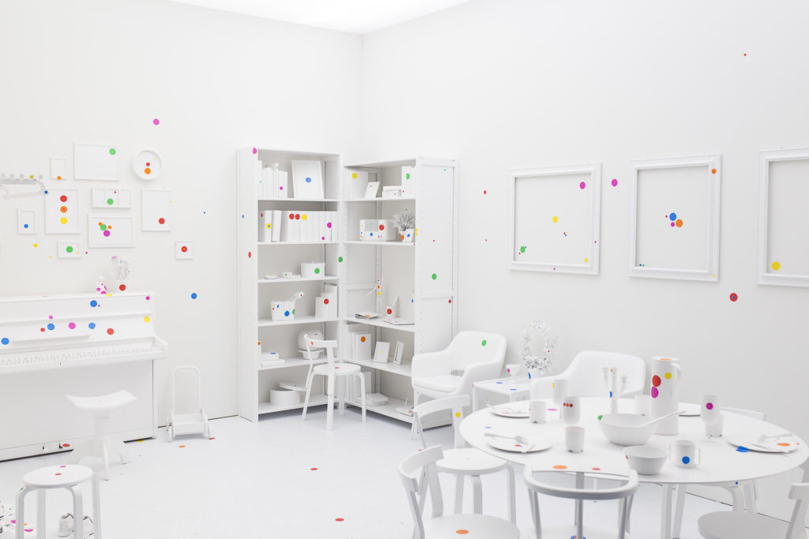

מה הופך בשנים האחרונות אולמות תעשייה אפלים לאטרקציית התרבות החמה ביותר? התשובה היא **תערוכות חוויה** — מיצגים אימרסיביים שבהם הצופה אינו עומד מול תמונה תלויה על קיר, אלא נבלע בתוך היצירה: ציורים מוקרנים על רצפה ותקרה, פסקול עוטף, ולעיתים מגע אינטראקטיבי שמשנה את מה שרואים. זוהי אחת המגמות המשמעותיות באמנות העכשווית, והיא כבר מזמן הגיעה גם אלינו.

## מה הן בעצם תערוכות חוויה?

בניגוד לתערוכה מסורתית, שבה האמנות נשמרת מאחורי חבל ומרחק של כבוד, תערוכות חוויה מתוכננות כדי לעטוף את הגוף כולו. הטכנולוגיה המרכזית היא הקרנת וידאו רבת־ערוצים (מה שמכונה לעיתים "פרוג'קשן מאפינג"), שהופכת חלל ריק לסביבה חיה ונושמת. יצירות של וינסנט ואן גוך, גוסטב קלימט או קלוד מונה מפורקות לפרטים, מונפשות ומוגדלות עד שהצופה חש כאילו הוא צועד לתוך "ליל כוכבים".

המשותף לכולן הוא המעבר מצפייה פסיבית להתנסות. הקהל מצלם, יושב על הרצפה, שוכב להביט בתקרה — ומתנהג אחרת לגמרי מכפי שהורגל במוזיאון. זהו שינוי תפיסתי עמוק באשר למה בכלל אומרת פגישה עם אמנות.

## למה הקהל נוהר לתערוכות חוויה?

הסוד נעוץ בשילוב בין נגישות לרגש. יצירת מופת קלאסית יכולה להרתיע מי שאינו "מבין באמנות", אך כשהיא עוטפת אותך בצלילים ובצבע, חומת החשש נופלת. **תערוכות חוויה** מצליחות למשוך דווקא את הקהל שנרתע ממוזיאונים — צעירים, משפחות עם ילדים, ומבקרים מזדמנים שמחפשים בילוי שאפשר גם לתעד ברשתות החברתית.

יש בכך גם היגיון כלכלי. בעולם שבו תשומת הלב מתחלקת בין מסכים, חוויה פיזית בלתי אמצעית הפכה למצרך יקר ערך. התערוכות הללו מוכרות לא רק יצירה אלא רגע — כזה שראוי לצאת מהבית בשבילו.

## המגמה מגיעה לישראל

גם בישראל התופעה תפסה תאוצה. חללי תצוגה בתל אביב ובמרכז הארץ אירחו בשנים האחרונות הקרנות ענק המוקדשות לאמני מופת, והמשיכו קהל רחב שמעולם לא עמד בתור ל**סינמטק** או ל**מוזיאון תל אביב לאמנות**. במקביל, מוסדות התרבות הממוסדים עצמם מתנסים יותר ויותר בטכנולוגיה, אור ומיצב, כדי לדבר עם דור שגדל על מסכים.

השאלה המעניינת היא האם מדובר בתחרות או בשער כניסה. רבים רואים בתערוכות החוויה דלת כניסה — מי שהתרגש מוון גוך מוקרן, עשוי יום אחד לרצות לעמוד מול הציור האמיתי.

## לא רק הקרנות: האמנים שמובילים את הגל

חשוב להבחין בין הקרנות מסחריות של יצירות קיימות לבין אמנות אימרסיבית מקורית. אמנים עכשוויים הפכו את החלל עצמו לחומר גלם:

- **יאיואי קוסאמה** — חדרי האינסוף שלה, רצופים נקודות ומראות, הפכו לאחת מחוויות האמנות המבוקשות בעולם.
- **אולפור אליאסון** — עובד עם אור, ערפל וצבע כדי לשנות את תפיסת החלל של הצופה.
- **טים לאב** (קולקטיב "טימלאב" מיפן) — מוזיאונים דיגיטליים שלמים שבהם היצירה מגיבה לתנועת המבקרים.

אלה אינם גימיקים אלא המשך ישיר לשורשים של אמנות המיצב והארט המושגי של המאה ה־20.

## טבלה: סוגי תערוכות חוויה

| סוג | מה רואים | למי זה מתאים |
|------|-----------|---------------|
| הקרנות ענק של מופת | וון גוך, קלימט, מונה מונפשים | משפחות, קהל רחב, מתחילים |
| חדרי אינסוף ומראות | מיצבים של קוסאמה וכדומה | חובבי צילום ואמנות עכשווית |
| מיצבי אור וסאונד | אליאסון, אמנות חללית | מחפשי חוויה מדיטטיבית |
| חללים אינטראקטיביים | אמנות דיגיטלית מגיבה | צעירים, חובבי טכנולוגיה |

## ביקורת: ראווה או עומק?

לא כולם מתלהבים. מבקרי אמנות מזהירים שחלק מהתערוכות הופכות יצירות מופת למסך רקע לצילום עצמי, ומדללות את המפגש האמנותי לרגע ויזואלי חולף. יש הטוענים שהקרנה של וון גוך, מרהיבה ככל שתהיה, אינה תחליף למכחול המקורי, לעובי הצבע ולנוכחות הפיזית של היצירה.

מנגד, המגמה מרחיבה את גבולות המוזיאון ומזמינה קהלים חדשים אל שולחן התרבות. ייתכן שזו בדיוק נקודת האיזון: תערוכות החוויה אינן מחליפות את האמנות הקלאסית — הן פותחות אליה דלת נוספת. השאלה שתלווה אותנו בשנים הקרובות היא עד כמה נצליח לשמור על העומק בתוך הזוהר.
