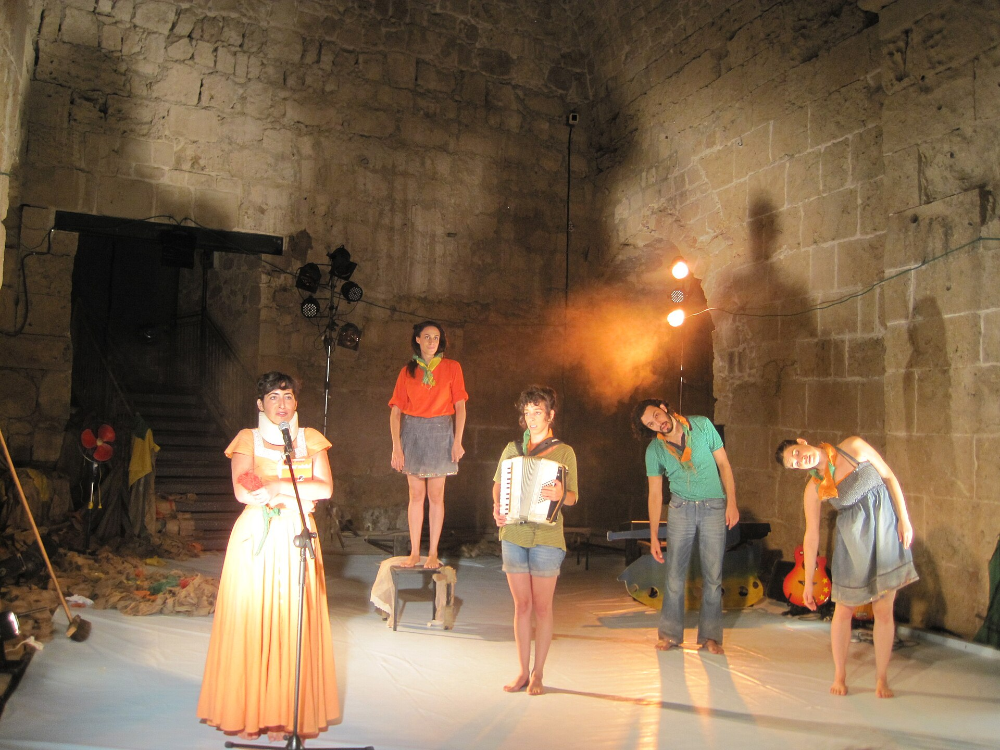

מה קורה כשמבטלים את השורה הראשונה, את המסך ואת הכיסא הממוספר? **תיאטרון אימרסיבי** הוא התשובה: צורת מופע שבה הצופה אינו יושב מהצד אלא נכנס פיזית אל תוך העולם הבדיוני, נע בין חדרים, עוקב אחרי דמות לבחירתו ולעיתים אף נוגע בתפאורה. זו אחת המגמות המרתקות בתיאטרון העכשווי, והיא מתחילה לתפוס תאוצה גם בישראל.

## מה זה בעצם תיאטרון אימרסיבי?

בניגוד להצגה קלאסית, שבה קיים גבול ברור בין הבמה לאולם, **תיאטרון אימרסיבי** מפרק את הגבול הזה לחלוטין. החלל כולו — מחסן נטוש, בית ישן, מלון, מרתף — הופך לזירת המשחק, והקהל הופך לחלק מהנוף. לעיתים מחלקים לצופים מסכות, לעיתים מזמינים אותם לפתוח מגירות, לקרוא מכתבים או ללוות שחקן ברגע אינטימי.

הרעיון אינו חדש לגמרי — שורשיו ניכרים בתיאטרון הרחוב, במיצגי האמנות של שנות השישים ובניסויים של יוצרים כמו יז'י גרוטובסקי — אך בעשור האחרון הוא קיבל שפה בימתית משוכללת ומסחרית.

## למה דווקא עכשיו?

בעידן שבו המסכים מתחרים על כל רגע מתשומת הלב שלנו, התיאטרון מחפש את מה שאי אפשר לשכפל: **נוכחות**. החוויה האימרסיבית מציעה בדיוק את זה — תחושה גופנית, ריח, קרבה פיזית לשחקן, רגע שלא ניתן לצלם ולהעלות לרשת. הדור שגדל על משחקי מחשב ועל חדרי בריחה מחפש השתתפות, לא רק צפייה, והתיאטרון החווייתי מדבר אליו בשפתו.

זו גם מגמה כלכלית. הפקות אימרסיביות מצליחות למכור כרטיסים במחירי פרימיום ולרוץ חודשים ארוכים, משום שכל ערב הוא חד-פעמי ובלתי ניתן לשחזור מדויק.

## המופע שהצית את הגל

רבים רואים בהפקה **'Sleep No More'** של הלהקה הבריטית פאנצ'דראנק (Punchdrunk) את ההפקה שהפכה את הז'אנר לתופעה בינלאומית. הקהל, עטוי מסכות לבנות, נודד בחופשיות בין קומות של בניין שהוסב ל'מלון' אפל, בעיבוד אילם ומצמרר ל'מקבת' של שייקספיר. מאז, יוצרים ברחבי העולם אימצו את העיקרון: לתת לצופה את חופש הבחירה, ובכך להפוך כל צפייה לסיפור אישי.

## תיאטרון אימרסיבי בישראל

בישראל, קרקע הניסוי הטבעית לז'אנר היא **פסטיבל עכו לתיאטרון אחר**, שבו מרחבי העיר העתיקה הופכים זה שנים לבמות חיות. גם בפסטיבלים כמו 'צומת' ו'ישראל' ובמרחבים אלטרנטיביים בתל אביב ובירושלים הולכות ומתרבות הפקות שמזמינות את הקהל לנוע, לגעת ולהשתתף.

המגמה ניכרת גם בשוליים התוססים של סצנת הפרינג', שם יוצרים צעירים מנצלים את חוסר התקציב כיתרון: במקום תפאורה יקרה, הם מציעים חלל אמיתי וקרבה בלתי אמצעית. התוצאה היא תיאטרון נועז, לעיתים לא מושלם, אך תמיד חי.

## טבלה: סוגי החוויה האימרסיבית

| סוג המופע | מידת ההשתתפות | מתאים ל... |
|---|---|---|
| נדודים חופשיים בחלל | גבוהה — הצופה בוחר מסלול | חובבי הרפתקה וגילוי |
| מופע אתר ייחודי | בינונית — תנועה מודרכת | אוהבי אדריכלות ואווירה |
| תיאטרון אינטימי לקבוצה קטנה | גבוהה מאוד — אחד על אחד | מחפשי חוויה רגשית עמוקה |
| מופע משתתף בישיבה | נמוכה — אינטראקציה נקודתית | מתלבטים שרוצים להתנסות בזהירות |

## מהם היתרונות — ומה האתגרים?

היתרון הגדול ברור: **אינטימיות ותחושת נוכחות** שאין כמותן. כשאתה עומד במרחק חצי מטר משחקן המתפרק לרסיסים, הריחוק הביקורתי מתמוסס והחוויה הופכת גופנית.

מנגד, האתגרים אמיתיים. הצופה מקבל חופש, אך משלם בכך שלעולם לא יראה את ההצגה כולה — תמיד יפספס סצנה שהתרחשה בחדר אחר. יש מי שנהנה מהחידתיות, ויש מי שיוצא מתוסכל. בנוסף, הז'אנר תובעני פיזית: שעתיים על הרגליים, לעיתים בחשכה, אינן מתאימות לכולם.

## איך להתכונן לערב אימרסיבי?

- **נעליים נוחות** — אתם הולכים ללכת הרבה.
- **ראש פתוח** — ותרו על הציפייה לעלילה ליניארית.
- **אומץ** — אם מזמינים אתכם לפעולה, אל תהססו.
- **הגיעו מוקדם** — כדי לקלוט את החלל לפני שהוא מתעורר לחיים.

## שורה תחתונה

**תיאטרון אימרסיבי** אינו סתם גימיק אופנתי, אלא ניסיון כן להחזיר לתיאטרון את מה שהפך אותו מלכתחילה לקסום: מפגש חי בין בני אדם, כאן ועכשיו. בישראל זהו עדיין שדה פורץ דרך, אך הסקרנות סביבו רק הולכת וגדלה. אם תזדמן לכם הצגה שמזמינה אתכם לקום מהכיסא — קומו. לפעמים מהמקום הכי לא צפוי צומחת החוויה הבלתי נשכחת.
