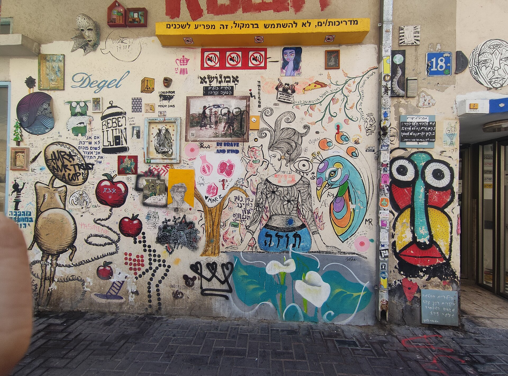

## מהי אמנות רחוב ולמה פלורנטין הפכה לבירה שלה?

אמנות רחוב היא יצירה חזותית שנוצרת במרחב הציבורי — על קירות, תריסים, מדרכות ועמודי חשמל — לרוב ללא הזמנה רשמית וללא תשלום כניסה. בשכונת פלורנטין שבדרום תל אביב, שבה מצטופפים מוסכים, בתי מלאכה וגלריות עצמאיות, הפכה אמנות הרחוב לשפה היומיומית של הרחוב עצמו. מי שמהלך בין רחוב וולובלסקי לאבולעפיה פוגש גלריה פתוחה, חינמית ומתחלפת, שבה כל קיר הוא בד אפשרי.

לא במקרה פלורנטין נחשבת בעיני רבים לאחת הכתובות המעניינות בעולם בכל הנוגע לאמנות עירונית. המרקם האורבני המתפורר, שילוב של עוני יצירתי וגל התחדשות, יצר קרקע אידיאלית: קירות ישנים שמחכים לצבע, וקהילה סובלנית שרואה בגרפיטי חלק מהנוף ולא מטרד.

## אילו סגנונות אפשר לפגוש על הקירות?

הסצנה המקומית מגוונת הרבה יותר ממה שנדמה למתבונן החולף. הנה כמה מהטכניקות הבולטות:

- **סטנסיל (שבלונה):** דימויים חדים ומהירים לביצוע, לרוב בעלי מסר פוליטי או אירוני.
- **מורל (ציור ענק):** יצירות קיר שלמות, צבעוניות ומוקפדות, שלעיתים לוקח ימים לצייר.
- **מדבקות ופוסטרים (פייסט־אפ):** שכבות על שכבות שמספרות את ההיסטוריה של הקיר.
- **טאגים וכתב (לטרינג):** החתימה הקלאסית של תרבות הגרפיטי, שממנה צמחה כל הסצנה.
- **פסיפסים ואובייקטים:** התערבות תלת־ממדית שמשתלבת בקיר הקיים.

### אמנות רחוב בין מחאה לקישוט

אחד הדברים המרתקים באמנות רחוב הוא המתח המובנה שבה. מצד אחד היא ממשיכה מסורת של מחאה חברתית — נגד יוקר המחיה, נגד פינוי שכונות, נגד מלחמות. מצד שני, בשנים האחרונות היא הפכה גם לכלי שיווקי: עסקים מזמינים אמנים לצייר על חזיתותיהם, ומה שהיה פעם מרד הפך לעיתים לעיצוב פנים אורבני. הדיון הזה — מתי זו אמנות ומתי זו פרסומת — מלווה את הסצנה בכל העולם, מברלין ועד ברוקלין.

## מי האמנים שמאחורי הקירות?

גם אם רבים מהיוצרים נותרים אנונימיים מאחורי כינויים, כמה דמויות התקבעו כסמלים של הסצנה הישראלית. דדה (Dede), עם דימוי הפלסטר האדום החוזר שהפך לחתימה מזוהה; קן (Kislev) ואחרים שעובדים בציורי ענק; וסינה (Zenith) וחבריהם לקולקטיבים שונים. לצידם פועלים אמנים בינלאומיים שמגיעים לצייר בעיר במסגרת פסטיבלים ואירועי אמנות.

חשוב לזכור: בשונה מתערוכה במוזיאון תל אביב לאמנות, כאן אין קטלוג ואין שילוט. חלק מהקסם הוא דווקא הבילוש — לזהות אמן לפי סגנונו, לגלות שכבה ישנה שנחשפה מתחת לחדשה.

## איפה כדאי להסתובב? מדריך קצר

| אזור | מה מחפשים | שעה מומלצת |
|---|---|---|
| רחוב וולובלסקי | מורלים גדולים וצבעוניים | שעות הבוקר, אור רך |
| רחוב אבולעפיה | סטנסילים ומדבקות | אחר הצהריים |
| שוק לוינסקי הסמוך | שילוב אוכל ואמנות | סוף שבוע |
| מתחם התחנה המרכזית | יצירות נועזות ופחות מתוירות | כל שעה, בזהירות |

## האם שווה לצאת לסיור מודרך?

בהחלט. בשנים האחרונות פרחו בפלורנטין סיורי אמנות רחוב מודרכים, שבהם מדריך — לעיתים אמן בעצמו — חושף את הסיפורים שמאחורי הקירות: מי צייר, נגד מה, ומה נמחק בינתיים. סיור כזה הופך את החוויה מהצצה אקראית להבנה עמוקה של שכבות התרבות והפוליטיקה שטבועות ברחוב. זו אחת הדרכים הנגישות והזולות ביותר להתוודע לאמנות עכשווית בישראל, ללא כרטיס כניסה.

### למה היצירות נעלמות — וזה בסדר

אחד המאפיינים המהותיים של אמנות רחוב הוא זמניותה. גשם, שמש, צביעה מחדש של בעלי בתים, או פשוט אמן אחר שמחליט לצייר מעל — כל אלה הופכים כל יצירה לרגע חולף. מה שמצולם היום לאינסטגרם עשוי להיעלם מחר. דווקא השבריריות הזו היא שמעניקה לסצנה את חיוניותה: הקיר אף פעם לא גמור, והשכונה היא יצירה בהתהוות מתמדת.

## שורה תחתונה

אמנות רחוב בפלורנטין היא הזמנה פתוחה — להאט, להרים את המבט מהטלפון, ולהבין שהמוזיאון הגדול ביותר בתל אביב נמצא בחוץ, חינם, מתחלף ובלתי צפוי. בין אם תצאו לסיור מודרך או סתם תשוטטו בעיניים פקוחות, השכונה תתגמל אתכם בשכבות על שכבות של יצירה ישראלית חיה.
